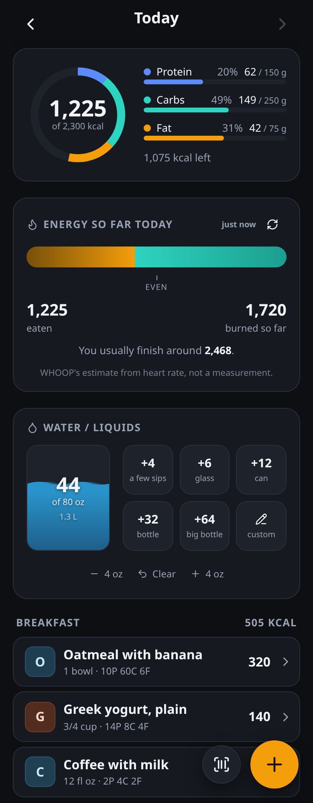

# Krakatoa

Krakatoa is a self-hosted food log, built as a phone-first PWA that keeps working
offline. You can scan a barcode, search, pick a generic food, build a chain-restaurant
order, photograph a nutrition label or a receipt, or type the food in. It then
tells you whether the day came out under or over, using WHOOP's estimate of the
calories you burned. I built it because I wanted a tracker that answers from real
data sources: a barcode is looked up in two databases, and generic foods come from
USDA's own household portions. Chain menus are read from each chain's published
nutrition, and anything the AI estimates is labelled as an estimate.

> This is a personal project. It was built for one user, and the author's copy
> runs on a home server. Each install has one owner account. You are welcome to
> run your own, but it is not a hosted service and was not designed for multiple
> users.

Formerly called **Fuel** (renamed 2026-10-02).



## Features

- **Barcode scanning.** Uses the native `BarcodeDetector` where the browser has
  it and zxing-wasm everywhere else, including iOS Safari. A lookup tries Open
  Food Facts first and then USDA FoodData Central, because each one has products
  the other lacks. GTINs are checksum-validated and tried in both their 12- and
  13-digit forms.
- **Search.** Open Food Facts (scoped to the US shelf) and USDA run in parallel
  and their results are interleaved. Local generic foods and chain menus show up
  instantly while the network results are still loading.
- **299 generic foods** with USDA's household portions (1 large egg, 1 tbsp
  butter, a 6-inch sub). They are generated from the USDA SR Legacy bulk download
  by a script. None of the numbers are typed by hand.
- **Restaurant menus (optional).** Build a bowl part by part or an order size by
  size, and watch the total update. The menu data is not necessarily included:
  `npm run build:menus` generates it from each chain's own published nutrition
  information (see [Restaurant menus](docs/self-hosting.md#restaurant-menus-optional)).
  Without it the app works as normal and the menu screen says none are built.
- **Nutrition label reader.** Photograph the Nutrition Facts panel and a headless
  Claude Code run fills in the form. It only fills the boxes, and checks the
  numbers against each other (calories vs. 4/4/9 macros and the like). You
  confirm before anything is saved. The food is then cached under its barcode.
- **Ask AI.** Send a receipt photo, a plate photo, or a description. The model
  matches items against your own foods, the chain menus and the USDA basics by ID,
  and Krakatoa computes the numbers from its own table. Only unmatched items are
  model estimates, and they are labelled. You can revise the list in conversation.
  Runs happen in the background as threads that survive closing the app or
  restarting the server. When a receipt is from a chain Krakatoa does not know,
  it can look up that chain's nutrition page, verify each item against the page,
  and add it as a new menu.
- **Combos** (saved meals). Log the parts once, save them as one item, and after
  that it is one tap. Favourites ("stars") pin foods you buy.
- **One screen per food.** It shows the food, a way to fix the entry you tapped,
  and every time you have logged it.
- **WHOOP energy balance** (optional, read from Bushido, which holds the WHOOP
  connection). Shows eaten vs. burned on one track. It won't give a
  verdict on a day that is still being counted or was never logged, and compares
  a partial day against your typical complete day.
- **Water**, with quick-add buttons for common container sizes and a 64 oz
  default target.
- **Offline first.** Every write goes to `localStorage` first and syncs later.
  The server merges per entry, and the newest write wins.
- **MCP server** at `POST /mcp` (16 tools: log food, search, edit, combos, Ask
  AI, water, targets). An assistant can log meals using Krakatoa's own numbers
  instead of guessing.
- **Set up in the browser.** On first run the server prints a one-time setup
  link. That link creates the owner account, and everything after that is
  configured under Settings: the AI, the food-database keys, optional
  integrations, and an API token for MCP clients. A fresh install starts with an
  empty log and every integration off.
- **Desktop layout.** At 1000px and wider the day becomes two columns with a
  sticky summary. From 720px up, overlays open as dialogs.

## Architecture

```
app/        React 19 + Vite PWA. Builds into ../dist.
  src/lib/    client logic: offline store, arithmetic, combos, menus, label checks
server/     Node HTTP server with zero npm dependencies (Node built-ins only)
  server.js   HTTP API, JSON-file store with per-entry merge, food cache, static files
  auth.js, pages.js   single-owner sign-in: setup token, scrypt, signed cookies
  settings.js   data/settings.json (0600), with env taking precedence
  lookup.js   Open Food Facts + USDA lookup and search
  nutrition.js  normalises both databases into one food shape
  label.js, ai.js, aithreads.js, learned.js   label reader and Ask AI (headless `claude`)
  mcp.js      MCP Streamable HTTP endpoint
  whoop.js    optional WHOOP burn, read from Bushido (which holds the grant)
  totem.js    optional Totem bridge: the habit push
  digest.js   compact day rollup written to data/digest.json for other tools
content/    generated data: basics.json (USDA); restaurants.json (chains, optional)
scripts/    generators for content/, with one reader per way a chain publishes
data/       runtime state, gitignored: the log, caches, backups, AI threads
```

- **Storage** is a JSON document (`data/state.json`) of entries keyed by ID. Each
  write is merged by `updatedAt`, and the server keeps rolling backups.
- **Macros are stored on each entry** at log time. If a database later edits a
  product, past days don't change.
- **AI features** start the Claude Code CLI as a child process with a temporary
  directory. Tools are restricted by flag (`Read`/`Grep`, plus web search and
  fetch for Ask AI's menu lookups), so no API key is stored in the app.

[AGENTS.md](AGENTS.md) records the reason behind each design decision and the
bugs that shaped them. Read it before changing anything substantial.

## Self-hosting quick start

You need Node.js 22 or newer.

```bash
git clone https://github.com/ehonis/krakatoa.git
cd krakatoa
npm install      # installs the frontend's build tools (the server has no dependencies)
npm start        # builds the app, then serves it on port 8101
```

1. Look at the terminal. On first run the server prints a one-time link:

   ```
   [krakatoa] No owner account yet. Open this link to set up Krakatoa (it works once):

       http://localhost:8101/setup?token=…
   ```

   Open it. If you are on another machine, replace `localhost` with the server's
   address, or set `KRAKATOA_PUBLIC_URL` so the link is printed correctly.
2. Choose a username and a password (10 characters or more). You are signed
   in and taken to **Settings**.
3. Under **AI**, follow what the status line says. The label reader and Ask AI
   run the [Claude Code CLI](https://docs.claude.com/en/docs/claude-code) on the
   server, so install it (`npm install -g @anthropic-ai/claude-code`). Then either
   run `claude` once as the same user to sign in, or paste an Anthropic API key.
   Press **Test**. Everything else in the app works without AI.
4. Optionally, under **Food databases**, add a free
   [USDA FoodData Central key](https://fdc.nal.usda.gov/api-key-signup.html).
   Without one, USDA lookups share `DEMO_KEY` (about 30 requests an hour).
5. Close Settings and log something.

The camera needs a secure context: use `https://` or `localhost`. Plain http to
a LAN IP gives a scanner that never starts.

With Docker instead (data kept in a named volume):

```bash
docker compose up -d --build
docker compose logs krakatoa     # the setup link is here
```

Set `WITH_CLAUDE: "1"` in `docker-compose.yml` to include the Claude Code CLI in
the image.

If the server already sits behind an authenticating proxy (such as Cloudflare
Access), `KRAKATOA_AUTH=proxy` turns off the built-in sign-in.

All configuration can also be set through environment variables, which take
precedence over Settings. They are listed in [.env.example](.env.example).
[docs/self-hosting.md](docs/self-hosting.md) covers sign-in, configuration,
data and backups, regenerating the content files, the optional integrations,
and running the app as a service.

For development, run the server (`npm run serve`) and, beside it, `npm run dev`,
which starts Vite on port 5173. Vite proxies `/api`, `/mcp`, `/login` and
`/setup` to the server on port 8101 (or `KRAKATOA_DEV_BACKEND`), keeping the
browser's Host header, so sign-in works through 5173 unchanged.

## Tests

```bash
npm test         # eslint (rules-of-hooks), the app and server suites, sign-in and fresh-install tests
npm run build
```

These are the same steps CI runs (`.github/workflows/ci.yml`, from `app/`).

## License

[MIT](LICENSE). The generated data in `content/` comes from third parties; see
[docs/self-hosting.md](docs/self-hosting.md#data-sources).
